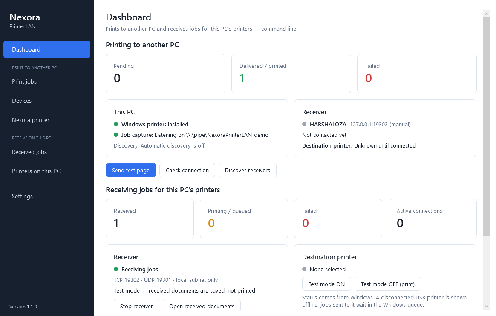

# Nexora Printer LAN

Print from any Windows application on one PC to a printer attached to another PC on the same local network.
Choose **Nexora Printer LAN** in the normal print dialog, click Print, and the job is sent automatically, encrypted,
to the receiver PC, which saves it (test mode) or prints it through the printer's own Windows driver.



## How it works

```
App ─print→ Windows queue "Nexora Printer LAN" (Nexora's own driver; XPS, vector — no PDF)
    ─Local Port \\.\pipe\NexoraPrinterLAN→ Nexora Printer LAN on PC1 ─TCP 9102, AES-256-GCM→ Nexora Printer LAN on PC2
    ─XPS printing (vector, image fallback)→ destination printer driver (e.g. Canon CAPT) → paper
```
If the Nexora driver cannot be installed, Setup uses Windows' Microsoft Print To PDF driver and jobs travel as PDF.

One app, `NexoraPrinterLAN.exe`, does both jobs: on each PC Setup installs the role(s) it needs — *Print to another
PC* and/or *Receive and print on this PC*. The PDF is only the hidden transport format; the receiver deletes it
after printing unless *Keep copies of printed jobs* is on. No custom driver, port monitor or kernel component is
installed. Details: [docs/ARCHITECTURE.md](docs/ARCHITECTURE.md).

## Status

Version 1.2.0 adds Nexora's own printer driver and XPS printing without PDF. Version 1.2.1 prints pages at true scale
(100%, e.g. 1:1 CAD plots) instead of shrinking them into the printer's margins. Version 1.2.2 adds per-printer size
calibration for printers that print slightly long or short in one direction; the Canon check is pending — see TEST_REPORT. Version 1.1.0 verified: queue creation and capture from Notepad, Word, Excel and GDI apps; encrypted, resumable
transfer; **PC1 → PC2 over Wi-Fi with automatic discovery** and a **physical page on the Canon LBP2900** (1.0.1);
the combined app; Setup install, upgrade from 1.0.x, role add/remove, uninstall and reinstall on PC1.
**Not yet verified:** 1.1.0 on PC2, multi-page/landscape/copies on the Canon, CAD applications (NX, AutoCAD,
SolidWorks). See [docs/TEST_REPORT.md](docs/TEST_REPORT.md) and [DEVELOPMENT_STATUS.md](DEVELOPMENT_STATUS.md).

## Quick start

1. Build Setup: `.\scripts\Package.ps1` → `release\NexoraPrinterLAN-1.2.2-x64.msi`.
2. **PC2** (printer PC): run the MSI, choose **Receive and print on this PC**, note the pairing code.
3. **PC1** (printing PC): run the same MSI (default **Print to another PC**), enter the pairing code in Settings.
4. Print to **Nexora Printer LAN** from any application. Uninstall from Apps & features.

Full instructions: [docs/INSTALLATION.md](docs/INSTALLATION.md) · Problems: [docs/TROUBLESHOOTING.md](docs/TROUBLESHOOTING.md)

## Repository layout

| Path | Contents |
|---|---|
| `src/Shared` | Models, config, security helpers, logging, PDF checks, winspool interop |
| `src/Transport`, `src/Discovery` | NXP/2 protocol and LAN discovery ([docs/NETWORK_PROTOCOL.md](docs/NETWORK_PROTOCOL.md)) |
| `src/PrintPipeline` | Client-side job capture from the Windows queue |
| `src/PrinterIntegration` | Receiver-side printing through installed drivers |
| `src/Client`, `src/Receiver` | Client and receiver engines (`*.Core`) |
| `src/App` | The combined WPF tray app `NexoraPrinterLAN.exe` |
| `src/UI` | Shared WPF theme and desktop helpers |
| `src/Tools/Nexora.Cli` | `nexora.exe` diagnostics / headless tool |
| `tests/Unit`, `tests/Integration` | xUnit tests (`scripts\Test.ps1`) |
| `scripts/` | Build, Test, Package, Diagnostics, queue install/uninstall, icon generator |
| `installer/msi` | WiX 4 Setup (roles, firewall, queue, upgrade from 1.0.x, uninstall) |
| `docs/` | Architecture, installation, protocol, security, troubleshooting, test report, screenshots |
| `legacy/` | Earlier Python prototypes (not used) |

## Development

Requirements: Windows 10/11 x64, .NET 8+ SDK.
```powershell
.\scripts\Build.ps1
.\scripts\Test.ps1
```
Security model: [docs/SECURITY.md](docs/SECURITY.md).

## License
[MIT](LICENSE). The self-contained packages include the .NET runtime, which is also
[MIT licensed](https://github.com/dotnet/runtime/blob/main/LICENSE.TXT); printing uses components of Microsoft Windows.
