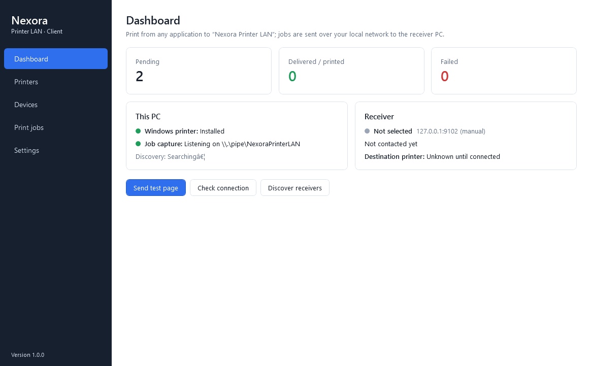

# Nexora Printer LAN

Print from any Windows application on one PC to a printer attached to another PC on the same local network.
Choose **Nexora Printer LAN** in the normal print dialog, click Print, and the job is sent automatically, encrypted,
to the receiver PC, which saves it (test mode) or prints it through the printer's own Windows driver.



## How it works

```
App ─print→ Windows queue "Nexora Printer LAN" (inbox Microsoft Print To PDF driver)
    ─Local Port \\.\pipe\NexoraPrinterLAN→ Nexora Client (PC1) ─TCP 9102, AES-256-GCM→ Nexora Receiver (PC2)
    ─Windows.Data.Pdf + GDI→ destination printer driver (e.g. Canon CAPT) → paper
```

No custom driver, port monitor or kernel component is installed. Details: [docs/ARCHITECTURE.md](docs/ARCHITECTURE.md).

## Status

Version 1.0.1. Verified: queue creation and capture from Notepad, Word, Excel and GDI apps; encrypted, resumable
transfer; client install and upgrade; **PC1 → PC2 over Wi-Fi with automatic discovery**; and a **physical page
printed on the Canon LBP2900** through its CAPT driver (one portrait text page).
**Not yet verified:** multi-page/landscape/copies on the Canon, CAD applications (NX, AutoCAD, SolidWorks). See
[docs/TEST_REPORT.md](docs/TEST_REPORT.md) and [DEVELOPMENT_STATUS.md](DEVELOPMENT_STATUS.md).

## Quick start

1. Build the packages: `.\scripts\Package.ps1` → `release\NexoraPrinterLAN-{Client,Receiver}-1.0.0-win-x64.zip`.
2. **PC2** (printer PC): extract the Receiver zip, run `Install-Receiver.cmd`, note the pairing code.
3. **PC1** (printing PC): extract the Client zip, run `Install-Client.cmd`, enter the pairing code in Settings.
4. Print to **Nexora Printer LAN** from any application.

Full instructions: [docs/INSTALLATION.md](docs/INSTALLATION.md) · Problems: [docs/TROUBLESHOOTING.md](docs/TROUBLESHOOTING.md)

## Repository layout

| Path | Contents |
|---|---|
| `src/Shared` | Models, config, security helpers, logging, PDF checks, winspool interop |
| `src/Transport`, `src/Discovery` | NXP/2 protocol and LAN discovery ([docs/NETWORK_PROTOCOL.md](docs/NETWORK_PROTOCOL.md)) |
| `src/PrintPipeline` | Client-side job capture from the Windows queue |
| `src/PrinterIntegration` | Receiver-side printing through installed drivers |
| `src/Client`, `src/Receiver` | Engines (`*.Core`) and WPF apps (`*.App`) |
| `src/UI` | Shared WPF theme and desktop helpers |
| `src/Tools/Nexora.Cli` | `nexora.exe` diagnostics / headless tool |
| `tests/Unit`, `tests/Integration` | xUnit tests (`scripts\Test.ps1`) |
| `scripts/` | Build, Test, Package, Diagnostics, queue install/uninstall, icon generator |
| `installer/` | Client and Receiver installers / uninstallers |
| `docs/` | Architecture, installation, protocol, security, troubleshooting, test report, screenshots |
| `legacy/` | Earlier Python prototypes (not used) |

## Development

Requirements: Windows 10/11 x64, .NET 8+ SDK.
```powershell
.\scripts\Build.ps1
.\scripts\Test.ps1
```
Security model: [docs/SECURITY.md](docs/SECURITY.md).
