# Nexora Printer LAN — Architecture

## 1. Goal

Print from any Windows application on PC1 to a printer physically attached to PC2 on the same LAN, by
choosing **Nexora Printer LAN** in the normal print dialog. No manual PDF saving or file copying.

## 2. Chosen Windows printing architecture (and why)

| Option considered | Verdict |
|---|---|
| **Inbox "Microsoft Print To PDF" v4 driver + Local Port named `\\.\pipe\NexoraPrinterLAN` + user-mode client** | **Selected.** Real Windows queue, Microsoft-signed driver, full XPS→PDF rendering pipeline, nothing installed into the spooler, works on Windows 10/11 x64 without driver signing. |
| Custom v4 driver package (XPSDrv / GPD) | Rejected for now: driver packages must be signed through the Microsoft Hardware Dev Center (EV certificate + attestation). Test-signing would require disabling signature enforcement, which this project must not ask for. |
| Custom port monitor DLL (e.g. the earlier `NexoraPortMon.dll`) | Rejected: runs inside `spoolsv.exe` as SYSTEM, needs admin registration, a crash takes down printing for the whole PC, and a port monitor alone is not a printer driver. Not needed because the inbox Local Monitor already writes each job to a named pipe. |
| IPP printer (Microsoft IPP Class Driver) pointing at an IPP server on PC2 | Viable future option (it is Microsoft's direction for Windows Protected Print Mode). Not chosen first because it bypasses the client (no offline outbox/retry), needs an IPP/HTTP server implementation that the Windows IPP class driver accepts, and fixed URLs break when DHCP addresses change. See §9. |
| Kernel-mode driver | Never needed; printing on Windows is user mode. |

Why it works: the Local Port monitor (`localspl.dll`) treats a port name that is not COM/LPT/FILE as a file path
and opens it with `CreateFile` at `StartDocPort`, writes the job with `WriteFile`, and closes it at `EndDocPort`.
A named-pipe path is a valid `CreateFile` target, so **each print job arrives as exactly one pipe connection
containing the complete PDF** produced by the inbox driver's filter pipeline. This was verified on PC1 with
PowerShell `Out-Printer`, Notepad, Microsoft Word, Microsoft Excel and a GDI application (see `TEST_REPORT.md`).
Named-pipe Local Ports are not described in Microsoft's documentation as a supported scenario; this is the main
platform risk and is called out in §8.

## 3. Components

```mermaid
flowchart LR
  subgraph PC1["PC1 — client (prints)"]
    App["Any Windows app\n(Word, Excel, AutoCAD, NX, …)"] -->|GDI / XPS print| Spool1["Windows spooler\nqueue: Nexora Printer LAN\ndriver: Microsoft Print To PDF"]
    Spool1 -->|Local Port\n\\\\.\\pipe\\NexoraPrinterLAN| Capture["Nexora Client\nPipeCaptureServer"]
    Capture --> Outbox[("Outbox\n%LOCALAPPDATA%\\Nexora\\Client")]
    Outbox --> Sender["Sender + retry\nstatus poller"]
    Disc1["Discovery client"] -.->|UDP 9101 broadcast| Disc2
  end
  subgraph PC2["PC2 — receiver (has the printer)"]
    Disc2["Discovery responder"]
    Server["ReceiverServer\nTCP 9102 (NXP/2)"] --> Store[("JobStore\nreceived_jobs + state")]
    Store --> PQ["PrintQueue"]
    PQ -->|test mode| Saved["Saved PDF only"]
    PQ -->|print mode| Render["Windows.Data.Pdf render\n→ System.Drawing.Printing"]
    Render --> Spool2["Windows spooler\nCanon LBP2900 (CAPT driver)"] --> Printer["Physical printer"]
  end
  Sender -->|TCP 9102\nAES-256-GCM, pairing-code auth| Server
```



| Project (src/) | Role |
|---|---|
| `Shared/Nexora.Shared` | Job model and states, JSON (safe, typed), config store, DPAPI secrets, pairing key, LAN address filter, safe file names, structured logging, PDF structure check, test-PDF generator, winspool interop (EnumPrinters/EnumJobs/DEVMODE). |
| `Transport/Nexora.Transport` | NXP/2 framing, HKDF key schedule, mutual HMAC handshake, AES-GCM `SecureChannel`, `TransportClient`/`ClientSession` (offer, resume, data, verdict, status, cancel, info). |
| `Discovery/Nexora.Discovery` | UDP request/announcement, HMAC-signed replies ("paired" receivers), responder with rate limit, auto-selection rule. |
| `PrintPipeline/Nexora.PrintPipeline` | Client-side capture: named-pipe server with restricted ACL, job-ticket read from the spooler at connect time, restart of jobs that stalled while the client was not running, queue inspector. |
| `PrinterIntegration/Nexora.PrinterIntegration` | Receiver-side printing: printer catalog with real spooler status, PDF rendering with Windows' built-in engine, printing through the destination driver, spool-job tracking. |
| `Client/Nexora.Client.Core` | Client engine: outbox, sender with resume and exponential backoff, discovery/IP-change handling, status polling. |
| `Receiver/Nexora.Receiver.Core` | Receiver host: TCP server, job store, print queue, discovery responder, retention. |
| `App/Nexora.App` | The single WPF tray app `NexoraPrinterLAN.exe`. Shows client pages (Print jobs, Devices, Nexora printer), receiver pages (Received jobs, Printers on this PC) or both, according to the roles Setup recorded in `HKLM\SOFTWARE\Nexora\PrinterLAN`. |
| `UI/Nexora.UI` | Shared WPF theme, MVVM helpers, tray icon, autostart, snapshot renderer. |
| `Tools/Nexora.Cli` | `nexora.exe` — headless receiver/client, discovery, send, status, printers, queue, PDF info, local print test. |

## 4. Process model

`NexoraPrinterLAN.exe` hosts the client engine and/or the receiver host in one process and runs **in the
signed-in user's desktop session** (started at sign-in by Setup's all-users autostart entry), not as a Windows service:

* Microsoft does not support `System.Drawing.Printing`/GDI printing from services; the receiver must print in a
  user session to drive vendor drivers such as Canon CAPT reliably.
* The client's pipe and DPAPI-protected pairing code belong to the user who prints.
* If the client is not running when someone prints, the spooler cannot open the port and marks the job *Error*;
  the job stays in the Windows queue and the client restarts it on start-up (verified).

Consequence: PC2 must be signed in for printing to happen (documented limitation; see §9 for a service design).

## 5. Job lifecycle and states

```
Client:   QUEUED → TRANSFERRING ─┬→ (receiver verdict) VALIDATED ─┬→ (test mode) final
                                 │                                └→ SUBMITTED_TO_PRINTER → PRINTING → COMPLETED
                                 └→ retry with backoff (QUEUED)    any → FAILED / CANCELLED
Receiver: RECEIVED (bytes on disk, SHA-256 matches) → VALIDATED (PDF structure ok, stored in received_jobs)
```

* `VALIDATED` is sent only after the file was flushed to disk, **re-read and hashed**; it never means "printed".
* `SUBMITTED_TO_PRINTER` = the destination driver accepted all pages (`EndDoc`).
* `PRINTING` = the Windows spooler reports the job printing.
* `COMPLETED` = the spooler finished sending the job to the device (or reports it printed). Windows cannot
  confirm paper actually came out; the UI says so.
* `DISCOVERED` applies to receivers (Devices page), not jobs.

## 6. Print settings

| Setting | How it travels |
|---|---|
| Paper size, orientation per page | Inside the PDF (each page's MediaBox, produced by the driver from the app's DEVMODE). The receiver picks the closest installed paper on the destination printer (±6 mm) and sets landscape per page. |
| Copies | The inbox PDF driver reports max copies = 1, so applications render extra copies into the PDF themselves (verified with Word: 2 copies → 2 pages, job ticket copies = 1). The job-ticket copy count is still sent and applied by the destination driver, for applications that leave copies to the driver. An application that did both would print copies² — not observed so far; check new CAD applications once. |
| Colour / monochrome | DEVMODE colour is sent; the receiver prints in colour only if the job asked for it and the printer supports it. |
| Page ranges | Applied by the application before rendering (only the selected pages reach the PDF). |
| Resolution | The PDF is vector; the receiver rasterises at the destination printer's DPI (capped by *Max render DPI*, default 600, and ~45 MP per page). |
| Custom sizes | Limited to the sizes the inbox PDF driver offers (A2–A6, B4/B5, Letter, Legal, Tabloid, ANSI C/D/E, Architecture sheets, envelopes). Arbitrary custom sizes would need a custom driver (§9). |

## 7. Technology choices

* **C# / .NET 8 (x64)** for everything: one language for networking, Windows interop (P/Invoke to winspool),
  WPF UI and tests. Retargeting to .NET 10 LTS is a one-line change (`NexoraTfm` in `Directory.Build.props`);
  releases are self-contained so PCs need no .NET install. .NET 8 support ends 10 Nov 2026, so retarget to .NET 10 LTS soon.
* **No C++ components**: no driver or spooler DLL is needed with the selected architecture. The installed
  WDK is not used.
* **Windows.Data.Pdf** (inbox WinRT PDF engine) for rendering on the receiver — no third-party PDF library.
* **System.Text.Json** with typed records only (no polymorphic type handling) for config, metadata and protocol.
* **xUnit** for unit and integration tests.
* **Windows Installer (WiX 4)** Setup with features per role, firewall rules from the WiX Firewall extension,
  and the queue created/removed by the audited PowerShell queue scripts run as deferred SYSTEM custom actions
  (see `installer/msi/NexoraPrinterLAN.wxs`, `INSTALLATION.md`). The app and CLI are self-contained single-file
  executables.
* Python is no longer used; the earlier prototypes are kept in `legacy/`.

## 8. Risks and uncertain platform behaviour

| Risk | Status / mitigation |
|---|---|
| Named-pipe Local Port is undocumented behaviour of localspl | Verified on Windows 11 build 26300 with the inbox PDF driver. `scripts/Diagnostics.ps1` and the client dashboard detect a broken queue. Fallback design: IPP (§9). |
| Windows Protected Print Mode (WPP) may restrict non-Mopria drivers/ports in future Windows | The Microsoft Print To PDF driver is retained under WPP; Local Port behaviour under WPP is **not tested**. |
| DEVMODE job ticket shows the queue default paper, not per-page sizes | Receiver uses PDF page geometry (authoritative). |
| Canon LBP2900 (CAPT, host-based) | Uses the vendor driver via GDI, which is how CAPT is designed to be used. **Not yet tested** — printer disconnected. |
| Receiver needs a signed-in session | Documented; service + session-agent design in §9. |

## 9. Future work

* IPP Everywhere endpoint on the receiver (`application/pdf`) for Windows Protected Print Mode compatibility.
* Windows service for receipt/storage on PC2 with a per-session print agent, so jobs are accepted while nobody is signed in.
* Signed custom v4 driver only if arbitrary custom paper sizes become a hard requirement (see §10).
* Vector print path on the receiver (draw PDF pages as vectors instead of 600-dpi bitmaps).

## 10. Could Nexora have its own printer driver?

Technically yes — a v4 print driver package (GPD/XPSDrv) named "Nexora" with any paper sizes (A0/A1 for CAD) and
its own options. It is not done because:

* Windows only installs **signed** driver packages: an EV code-signing certificate, a Microsoft Partner Center
  hardware account and attestation (or HLK/WHQL) signing for every release. Test-signing is not acceptable here.
* Microsoft's *End of servicing plan for third-party printer drivers* (announced September 2023; Microsoft's page
  lists 2026 for preferring the inbox IPP class driver and 2027 for stopping third-party driver updates except
  security fixes) moves Windows printing to the inbox **IPP class driver** plus **Print Support Apps**.
* The inbox driver already covers the printing need; only paper sizes beyond its list are limited.

The future-proof way to a branded "own printer" is therefore an IPP endpoint (Microsoft IPP Class Driver, no
driver package) with an optional Print Support App for custom options — see §9.
